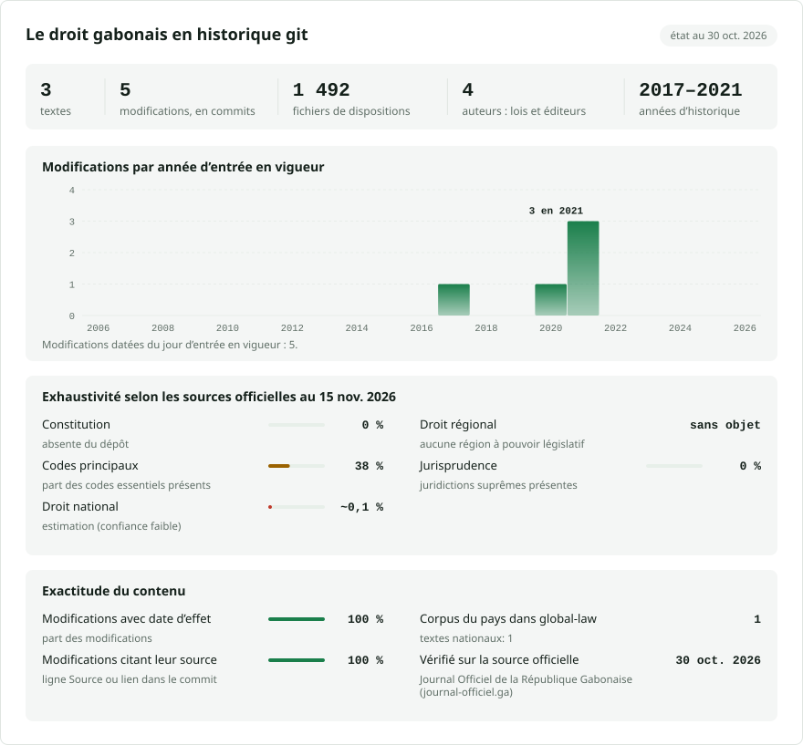

# Gabon : l’historique du droit dans git

**Français** · [English](README.en.md)

<picture>
<source media="(prefers-color-scheme: dark)" srcset="data/fr/effort-dark.svg">

</picture>

Le droit gabonais sous forme d’historique git : un fichier par article, un commit par version au jour de son entrée en vigueur, et pour auteur de chaque commit la loi qui a apporté la modification. `git blame` désigne la loi à l’origine de chaque ligne ; `git log` énumère toutes les modifications d’un article ; le choix d’une date donne le texte en vigueur ce jour-là.

Fait partie de [lexifina/global-law](https://github.com/lexifina/global-law), un historique git unique pour le droit de chaque pays : ce dépôt contient le droit national gabonais, que global-law lit dans `gabon/national/acts/`.

**Contenu actuel :** trois textes, en 5 versions : la Constitution de 1991 telle que modifiée jusqu’en 2021 (133 articles, une version), le Code pénal de 2020 (694 articles, deux versions) et la première partie du Code civil, relative aux personnes et à la famille (648 articles, deux versions). Le `README.md` de chaque texte en énumère les articles et la date de la dernière modification de chacun ; [`data/laws.csv`](data/laws.csv) énumère les 17 lois que mentionne le registre.

Chaque texte est un dossier, et chaque article un fichier nommé d’après son numéro imprimé : `code-penal/art-230.md` est l’article 230 du Code pénal, `code-penal/art-223-4-bis.md` est l’article 223-4 bis, et le préambule de la Constitution est `constitution/preamble.md`.

Le texte est en français, tel que l’imprime le Journal Officiel. Une traduction anglaise ne fait pas partie de ce registre.

## Questions sous forme de commandes git

| Question | Commande |
| --- | --- |
| Toutes les modifications de l’article 230 du Code pénal | `git log -p --word-diff -- code-penal/art-230.md` |
| Quelle loi a écrit chaque ligne de l’article 230 ? | `git blame code-penal/art-230.md` |
| Toutes les versions du Code pénal, avec le jour d’entrée en vigueur de chacune | `git log --format="%h %(trailers:key=In-force,valueonly,separator=) %an" -- "code-penal/art-*"` |
| L’article 230 tel qu’en vigueur le 1er janvier 2021 | `python tools/on.py 2021-01-01 code-penal art-230` |

**En dehors de git**, nous hébergeons aussi ce registre publiquement, gratuitement :

- **[Interroger Claude sur le droit gabonais](https://global-law.lexifina.com/v1/try_claude?country=gabon)** : ouvre Claude avec une première question prête.
- **[Interroger ChatGPT](https://global-law.lexifina.com/v1/try_chatgpt?country=gabon)** : la même question dans ChatGPT.
- **[Rechercher dans le droit gabonais sur notre site](https://lexifina.com/law?country=gabon&q=mariage)** : une recherche de « mariage », avec le texte de chaque disposition et ses versions, sans compte.
- **[API REST pour les développeurs](https://global-law.lexifina.com/v1/search_law?query=mariage&jurisdiction=gabon)** : la même recherche en JSON, sans clé. Voir la [documentation ici](https://lexifina.com/api/global-law).

Les deux assistants lisent le registre au moyen du connecteur gratuit Global law (MCP, `https://global-law.lexifina.com/mcp`) ; la première fois, la conversation vous donne le lien qui l’ajoute. Posez vos questions en français ou en anglais.

**L’héberger vous-même, simplement.** Il suffit de git et de Python, et les outils s’exécutent sur votre machine :

```sh
git clone --depth 1 https://github.com/lexifina/global-law && cd global-law
python3 tools/countries.py add gabon/national/acts
python3 tools/law.py show 2026-01-01 gabon/national/acts/code-penal/art-230.md
```

Ouvert dans Claude Code, Cursor, VS Code ou Codex, le clone lance aussi un serveur MCP local doté des mêmes outils ([MCP.md](https://github.com/lexifina/global-law/blob/main/MCP.md)).

## Dates

Chaque commit est daté à midi, heure de Libreville (Africa/Libreville), du jour où la version est entrée en vigueur, et porte ce jour dans son trailer `In-force:` :

- le Code pénal tel qu’adopté : le 30 juin 2020, jour de la promulgation et de la publication de la loi n°006/2020 (Journal officiel n°72 bis spécial) ;
- les modifications apportées en 2021 aux deux codes : le 16 septembre 2021, jour de la publication de la loi n°005/2021 et de la loi n°004/2021 (Journal officiel n°131) ;
- la Constitution et la première version du Code civil : la date de la loi la plus récente que la source indique comme intégrée (loi n°046/2020 du 11 janvier 2021 ; loi n°003/2017 du 3 août 2017). La source n’indique aucun autre jour d’entrée en vigueur de ces textes.

Chaque modification est attribuée à la loi qui l’a faite (`Loi 005/2021`). La Constitution et la première version du Code civil sont attribuées à l’éditeur, le Journal Officiel, en tant que « plus ancienne version disponible », et leurs messages de commit nomment les lois que le texte intègre déjà (la Constitution de 1991 et ses huit lois modificatives ; les lois n°15/72, n°009/2010 et n°003/2017).

## Comment il est vérifié

- `tools/check_repo.py` relit chaque version depuis git au jour de son entrée en vigueur et la veille, et la compare au corpus : 5 versions de 3 textes, aucune divergence.
- Les trailers de chaque commit se lisent sans erreur ; il n’existe aucun commit de fusion, les dates des commits ne reculent jamais et aucune n’est postérieure à la construction.
- Le Code pénal de 2020 concorde article par article avec le texte publié de la loi n°006/2020, à l’exception de deux différences typographiques (articles 75-7 et 318).
- `tools/build.py` écrit l’historique à partir d’un seul fichier de corpus, et le même corpus donne les mêmes empreintes de commit ; aucune seconde construction n’a encore été comparée. Le détail figure dans [`REPRODUCE.md`](REPRODUCE.md).
- [vulnerabilities/](vulnerabilities/): erreurs de rédaction possibles dans ce droit, trouvées par les détecteurs de global-law et vérifiées à la main. Pas encore lancé.

## Ce qu’il ne montre pas

- **La Constitution en vigueur.** Le Gabon a adopté une nouvelle Constitution par référendum le 16 novembre 2024, promulguée le 19 décembre 2024. Le site du Journal Officiel n’en publie pas le texte ; la Constitution présentée ici est donc le texte de 1991 qu’elle a remplacé.
- **Les rédactions antérieures.** La première version de la Constitution intègre déjà ses modifications de 1994 à 2021, et celle du Code civil les lois de 2010 et de 2017 ; il n’existe aucun historique antérieur à celles-ci.
- **Un texte officiel de 2021.** Le site ne publie aucun texte consolidé postérieur aux lois de 2021 : les versions de 2021 appliquent au texte antérieur les modifications de chaque loi (voir `REPRODUCE.md`). La loi n°004/2021 modifie également les articles 699 et 700, situés dans la seconde partie du Code civil, qui ne sont pas appliqués ; les modifications ultérieures, s’il en existe, ne figurent pas ici.
- **La majeure partie du droit gabonais.** La seconde partie du Code civil, le Code de commerce, le Code de procédure pénale et les autres codes ne figurent pas ici : le site ne les présente que sous forme d’images, ou pas du tout. Le droit commercial relève en grande partie des Actes uniformes de l’OHADA.
- **Les intitulés et les notes.** Les intitulés des codes (Livre, Titre, Chapitre, Section), les blocs de signature de la Constitution et les notes nommant les lois modificatives sont omis. La source ne comporte pas d’articles 220 et 614 du Code civil.

## Sources

| Source | Nature | Versions antérieures | Remarques |
| --- | --- | --- | --- |
| [Journal Officiel de la République Gabonaise](https://journal-officiel.ga) | Journal officiel : la Constitution, les codes et les lois | non, un seul texte consolidé par acte | Les pages de la Constitution, du Code pénal et du Code civil, et les lois n°006/2020, n°005/2021 et n°004/2021, consultées les 29 et 30 octobre 2026 |

## Licence

Voir [`LICENSE`](LICENSE). Le site ne publie aucune licence pour ses pages consacrées à la législation ; les textes constituent le droit public de la République gabonaise, reproduits avec mention de leur source, et leur statut au regard du droit d’auteur n’est pas confirmé. Les contributions propres de Lexifina (l’historique, les messages de commit, les tableaux et les outils) sont versées au domaine public sous CC0 1.0.

Aucun modèle d’IA n’a écrit, traduit ou corrigé de texte juridique ; les scripts ont été écrits par un modèle d’IA (voir [`REPRODUCE.md`](REPRODUCE.md)).

Ceci est une traduction de la version anglaise ([README.en.md](README.en.md)) ; en cas de divergence, la version anglaise fait foi.

## Visualisations

- [visualisations/](visualisations/): graphiques tirés de ce dépôt. Pas encore dessinés.

## En savoir plus

Dans le dépôt [lexifina/global-law](https://github.com/lexifina/global-law) (pages en anglais) :

- [FEATURES.md](https://github.com/lexifina/global-law/blob/main/FEATURES.md): toutes les fonctionnalités et ce que chaque corpus doit prendre en charge (`git blame`, `law.py`, outils MCP)
- [FAQ.md](https://github.com/lexifina/global-law/blob/main/FAQ.md): questions et réponses · [CONTRIBUTING.md](https://github.com/lexifina/global-law/blob/main/CONTRIBUTING.md): proposer une modification · [MCP.md](https://github.com/lexifina/global-law/blob/main/MCP.md): serveur MCP · [REPRODUCE.md](https://github.com/lexifina/global-law/blob/main/REPRODUCE.md): comment il a été construit · [CHANGELOG.md](https://github.com/lexifina/global-law/blob/main/CHANGELOG.md)
- [FRESHNESS.md](https://github.com/lexifina/global-law/blob/main/FRESHNESS.md): à quel point chaque corpus est à jour · [Surveillance](https://github.com/lexifina/global-law/tree/main/monitoring): si les mises à jour fonctionnent · [WATCHING.md](https://github.com/lexifina/global-law/blob/main/WATCHING.md): comment chaque source officielle est surveillée pour repérer les modifications
- [performance/](https://github.com/lexifina/global-law/tree/main/performance): la rapidité des outils, mesurée
- [visualisations/](https://github.com/lexifina/global-law/tree/main/visualisations): graphiques et liens à travers le droit du monde entier
- [Vulnérabilités](https://github.com/lexifina/global-law/tree/main/vulnerabilities): erreurs dans les textes tels qu’ils ont été publiés
